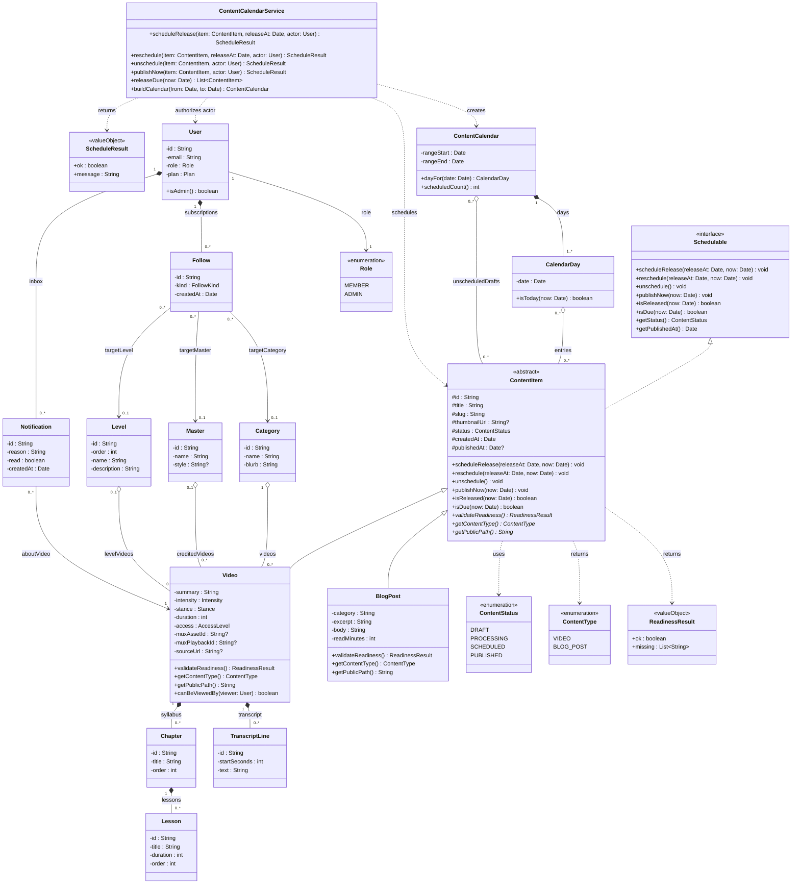
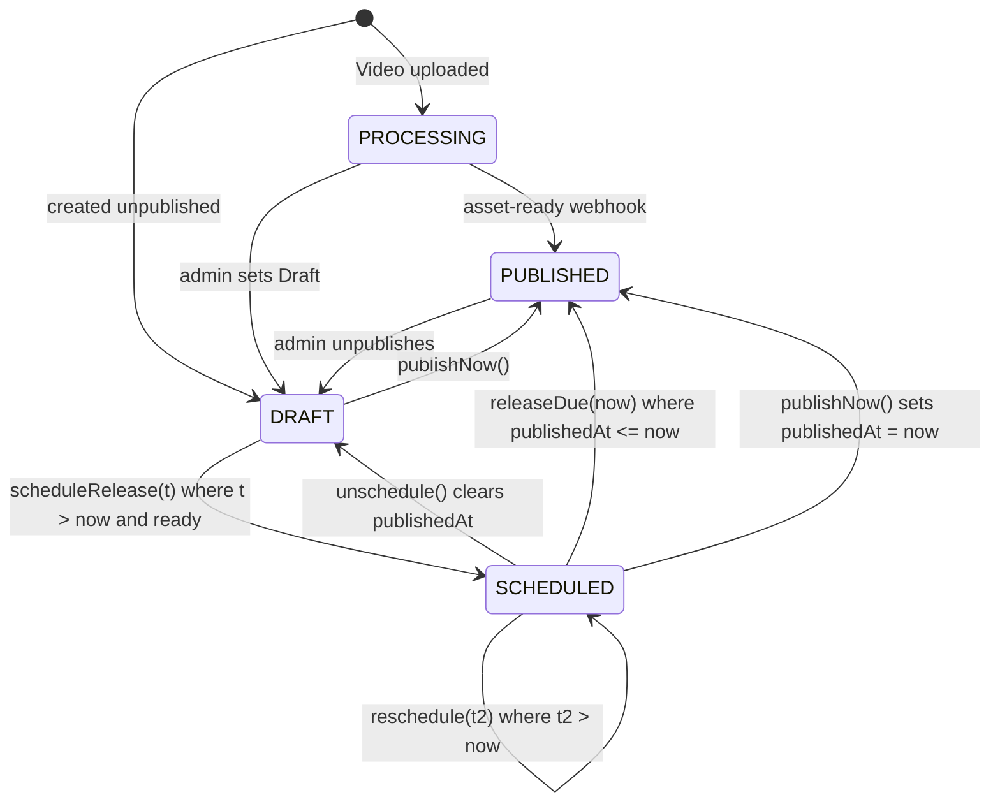

# Phase 1 — UML Class Diagram & Relationship Design (Content Calendar)

| Full Name          | Student ID | Email Address                    |
| ------------------ | ---------- | -------------------------------- |
| Yahya Chebab       | 300211534  | yahya.chebab@student.ufv.ca      |
| Riley Van Dam      | 300194967  | Riley.vandam@student.ufv.ca      |
| Manbir Singh Sidhu | 300200328  | ManbirSingh.Sidhu@student.ufv.ca |
| Jovan Siekham      | 300183572  | anmolak.siekham@student.ufv.ca   |

---

## 0. Phase 1 scope, requirements, and steps

### Scope
Phase 1 is the **data contract** for the Content Calendar. It specifies every class the
feature touches, every relationship between them (type, multiplicity, and role names), the
lifecycle of a piece of content, and how each part maps onto `prisma/schema.prisma`.
Phase 1 does not change any code. Phases 3 and 4 implement exactly what is written here.

### Requirements (traced to Mini-Project 1)

| ID | Requirement | Source |
| -- | ----------- | ------ |
| R1 | An admin can schedule a `DRAFT` video for a future release date and time. | MP1 Step 4, main scenario 2–6 |
| R2 | A release time at or before "now" is rejected. | MP1 Step 4, alternate flow 1 |
| R3 | Content missing mandatory fields (instructor, syllabus) cannot be scheduled. | MP1 Step 4, alternate flow 2 |
| R4 | Scheduled content stays invisible to non-admins until it is released. | MP1 Step 5, countermeasure |
| R5 | Only `ADMIN` users may schedule, reschedule, unschedule, or release. | MP1 Step 4, step 4 (`requireAdmin()`) |
| R6 | `Video` and `BlogPost` share one scheduling abstraction (`ContentItem`). | MP1 Step 1, §3 inheritance proposal |
| R7 | When content is released, followers are notified and caches are refreshed. | Existing `fanOutNewVideo` (`src/lib/notifications.ts`); solved properly in Phase 2 |
| R8 | Admins see a calendar of scheduled items, plus a list of unscheduled drafts. | MP1 Step 4, step 1 (`/admin/content/calendar`) |

### Steps completed in this phase
1. Surveyed the existing classes in `prisma/schema.prisma`, `src/lib/domain.ts`, `src/lib/notifications.ts`, and `src/actions/*`.
2. Chose the new abstractions: `Schedulable`, `ContentItem`, `ContentCalendarService`, `ContentCalendar`, and `CalendarDay`.
3. Drew the full class diagram (§1).
4. Wrote a class dictionary (§2).
5. Classified every relationship and justified each choice against how the database actually behaves (§3).
6. Recorded the interface/abstract-class and is-a/has-a decisions, including the alternatives we rejected (§4).
7. Specified the `ContentStatus` state machine and the invariants (§5).
8. Defined the persistence mapping and the schema change Phase 4 will make (§6).
9. Wrote a hand-off checklist for teammates (§7).

---

## 1. Class diagram

Legend: `<|--` inheritance · `<|..` interface realization · `*--` composition (filled diamond on the owner) · `o--` aggregation (hollow diamond on the whole) · `-->` directed association · `..>` dependency. Field visibility: `+` public, `#` protected, `-` private. A `?` after a type means `[0..1]` (optional).



> **Scope note.** `Progress`, `SavedVideo`, `LessonCompletion`, `MoodCheckIn`, `Session`, `HealthCheckIn`, and `Plan` already exist in the schema but are left out of the diagram. None of them takes part in scheduling or release, and drawing them would bury the feature. They are unchanged.
>
> **Phase 2 note.** The Observer pattern classes (`ReleaseObserver`, the concrete observers, and `ContentCalendarService` acting as the subject) are added to this diagram in Phase 2. Phase 1 deliberately shows the design *before* the pattern, so the design problem is visible.

---

## 2. Class dictionary

"Status" means **Existing** (already in the codebase), **New** (added by this feature), or **Changed** (existing, but modified by this feature).

| Class | Stereotype | Status | Responsibility | TypeScript home (Phase 4) |
| ----- | ---------- | ------ | -------------- | ------------------------- |
| `Schedulable` | «interface» | New | The contract for anything that can be put on the calendar. It says *what* can be done to content, not how. | `src/lib/domain.ts` (type) |
| `ContentItem` | «abstract» | New | Holds the state shared by all content (`title`, `slug`, `status`, `publishedAt`) and implements the scheduling state machine once, in one place. Subclasses fill in `validateReadiness()`, `getContentType()`, and `getPublicPath()`. | `src/lib/domain.ts` (base type + pure functions) |
| `Video` | entity | Changed | A training session. Its readiness rule requires a master (instructor), at least one chapter, a positive duration, and a playable source. | `prisma.video` |
| `BlogPost` | entity | Changed | A *Steady Path Journal* article. Its readiness rule requires a body of at least 50 characters and an excerpt. Gains a `status` column so posts can be scheduled. | `prisma.blogPost` |
| `ContentStatus` | «enumeration» | Changed | Adds `SCHEDULED` to the existing `DRAFT \| PROCESSING \| PUBLISHED`. | `VIDEO_STATUSES` in `domain.ts` |
| `ContentType` | «enumeration» | New | Tells the calendar's entries apart. | `domain.ts` |
| `ReadinessResult` | «valueObject» | New | `{ ok, missing[] }`. Lists every missing field at once, so the admin fixes them all in one pass instead of one per attempt. | `domain.ts` |
| `ContentCalendarService` | «control» | New | The only place where scheduling use cases run. It authorizes the actor, delegates the state transition to `ContentItem`, and persists the result. | `src/actions/admin-calendar.ts` |
| `ScheduleResult` | «valueObject» | New | Same shape as the existing `AdminResult` (`{ ok, message }`). | `src/actions/admin.ts` (`AdminResult`) |
| `ContentCalendar` | read model | New | A calendar grid for a date range, plus the drafts that have no date yet. | `src/lib/queries.ts` (`getContentCalendar`) |
| `CalendarDay` | read model | New | One cell of the grid. Exists only inside a `ContentCalendar`. | `queries.ts` (type) |
| `Category` / `Master` / `Level` | entity | Existing | Shared catalog reference data. | `prisma.category` / `master` / `level` |
| `Chapter` / `Lesson` / `TranscriptLine` | entity | Existing | Parts of a video. | `prisma.chapter` / `lesson` / `transcriptLine` |
| `User` | entity | Existing | Member or staff account. `role` decides whether the user may schedule. | `prisma.user`, `Viewer` in `src/lib/auth.ts` |
| `Follow` | entity | Existing | A member's subscription to exactly one category, master, or level. | `prisma.follow` |
| `Notification` | entity | Existing | One inbox item about one released video. | `prisma.notification` |

---

## 3. Relationship classification

Each row names both association ends as *multiplicity / role*. "DB realization" is how the relationship already is, or will be, enforced in `prisma/schema.prisma`. That column is how we checked each classification: if the database lets a part outlive its whole, the relationship is not composition.

### 3.1 Inheritance and realization ("is-a" / "can-do")

| # | Relationship | Type | Justification | DB realization |
| - | ------------ | ---- | ------------- | -------------- |
| 1 | `Video` → `ContentItem` | Inheritance | A video **is a** piece of content. It passes the substitution test: anywhere the calendar expects a `ContentItem` (schedule, reschedule, list by date), a `Video` works without special-casing. | Table-per-concrete-class (§6.1). There is no `ContentItem` table. |
| 2 | `BlogPost` → `ContentItem` | Inheritance | A blog post **is a** piece of content. It shares `title`, `slug`, `thumbnailUrl`, `status`, and `publishedAt` (the fields MP1 Step 1 found duplicated). | Same as #1. |
| 3 | `ContentItem` ⇢ `Schedulable` | Interface realization | `ContentItem` **can be** scheduled. The capability is kept separate from the base class (§4.1). | None. This is a behavioural contract. |

### 3.2 Composition (strong ownership; the part's lifetime is bound to the whole)

| # | Whole (mult / role) | Part (mult / role) | Justification | DB realization |
| - | ------------------- | ------------------ | ------------- | -------------- |
| 4 | `Video` 1 / `video` | `Chapter` 0..\* / `syllabus` | A chapter means nothing without its video, belongs to exactly one video, and is never shared or moved. | `Chapter.videoId` required, `onDelete: Cascade` |
| 5 | `Chapter` 1 / `chapter` | `Lesson` 0..\* / `lessons` | Same reasoning, one level down. Deleting a chapter removes its lessons (`deleteChapter` reports "Removed … and its lessons"). | `Lesson.chapterId` required, `onDelete: Cascade` |
| 6 | `Video` 1 / `video` | `TranscriptLine` 0..\* / `transcript` | Caption lines are part of the video's content. `saveTranscript` replaces them all at once. | `TranscriptLine.videoId` required, `onDelete: Cascade` |
| 7 | `ContentCalendar` 1 / `calendar` | `CalendarDay` 1..\* / `days` | A day cell is created by, and only exists inside, the calendar that built it. Every calendar has at least one day. | In memory only (read model) |
| 8 | `User` 1 / `follower` | `Follow` 0..\* / `subscriptions` | A follow is the member's own preference, has no meaning without that member, and is never transferred. | `Follow.userId` required, `onDelete: Cascade` |
| 9 | `User` 1 / `recipient` | `Notification` 0..\* / `inbox` | A notification is one member's inbox item and dies with the member. | `Notification.userId` required, `onDelete: Cascade` |

### 3.3 Aggregation (whole–part, but the parts are shared and outlive the whole)

| # | Whole (mult / role) | Part (mult / role) | Justification | DB realization |
| - | ------------------- | ------------------ | ------------- | -------------- |
| 10 | `Category` 1 / `focusArea` | `Video` 0..\* / `videos` | A focus area groups videos, but a video is not *part of* its category. The video survives a move to another category. `deleteCategory` **refuses** to delete a category that still has videos instead of cascading. | `Video.categoryId` required, no cascade (Restrict) |
| 11 | `Master` 0..1 / `instructor` | `Video` 0..\* / `creditedVideos` | An instructor is credited on videos, which exist independently. `deleteMaster` refuses while credits remain. | `Video.masterId` optional, no cascade |
| 12 | `Level` 0..1 / `level` | `Video` 0..\* / `levelVideos` | A rung of the progression ladder groups videos. `deleteLevel` nulls `Video.levelId` and keeps the videos. | `Video.levelId` optional, no cascade |
| 13 | `CalendarDay` 0..\* / `day` | `ContentItem` 0..\* / `entries` | A day *shows* the items released on it. Throwing the calendar away never deletes content. `0..*` on the day end: an item appears in a day only if its `publishedAt` falls in the viewed range. | Read model; items come from `prisma.video` / `blogPost` |
| 14 | `ContentCalendar` 0..\* / `calendar` | `ContentItem` 0..\* / `unscheduledDrafts` | The side list of drafts with no date yet. Same shared, non-owning reasoning. | Read model |

### 3.4 Association (structural link, no ownership)

| # | End A (mult / role) | End B (mult / role) | Justification | DB realization |
| - | ------------------- | ------------------- | ------------- | -------------- |
| 15 | `Notification` 0..\* / `notifications` | `Video` 1 / `aboutVideo` | A notification *refers to* a video, but the video does not own it: the notification belongs to the member's inbox (#9). See §4.4 for why we don't call this composition, even though the FK cascades. | `Notification.videoId` required, `onDelete: Cascade` (referential cleanup) |
| 16 | `Follow` 0..\* / `followers` | `Category` 0..1 / `targetCategory` | A follow *points at* what it follows. Exactly one of #16–#18 is non-null and matches `Follow.kind` (invariant I5). | `Follow.categoryId` optional |
| 17 | `Follow` 0..\* / `followers` | `Master` 0..1 / `targetMaster` | As above. | `Follow.masterId` optional |
| 18 | `Follow` 0..\* / `followers` | `Level` 0..1 / `targetLevel` | As above. | `Follow.levelId` optional |
| 19 | `User` 1 | `Role` 1 / `role` | Every user has exactly one role. This is a **has-a** attribute, not a subclass (§4.3). | `User.role` String, default `"MEMBER"` |

### 3.5 Dependency (transient "uses")

| # | Client | Supplier | Why it is only a dependency |
| - | ------ | -------- | --------------------------- |
| 20 | `ContentCalendarService` | `ContentItem` | The service receives items as method arguments and keeps no reference to them between calls (it is stateless, like every Server Action). |
| 21 | `ContentCalendarService` | `User` | The actor is passed in only so the service can authorize it (`requireAdmin()`). |
| 22 | `ContentCalendarService` | `ContentCalendar` | The service builds a calendar and returns it («create»). It does not hold on to it. |
| 23 | `ContentItem` | `ContentStatus`, `ContentType`, `ReadinessResult` | Value and enum types used in signatures. |

---

## 4. Design decisions

### 4.1 Interface **and** abstract class, not one or the other

| Option | Verdict | Reason |
| ------ | ------- | ------ |
| Only an abstract class `ContentItem` | ❌ Rejected | It would tie "can be scheduled" to "is a content row". The calendar may later hold things that aren't content, such as a live-class event or a `Plan` promo window. With only an abstract class, those would have to inherit `slug` and `thumbnailUrl` they don't need. |
| Only an interface `Schedulable` | ❌ Rejected | `Video` and `BlogPost` would each have to re-implement the same state machine (DRAFT → SCHEDULED → PUBLISHED, the future-date check, `isReleased`). That is the duplication MP1 Step 1 pointed out, and two copies of a security-relevant rule (R4) will drift apart. |
| **Interface `Schedulable` + abstract `ContentItem implements Schedulable`** | ✅ Chosen | The interface is the *capability* that the calendar and service depend on. The abstract class is the *shared implementation* for content. The transition logic is written once, and subclasses supply only what really differs (`validateReadiness`, `getPublicPath`). This is a small Template Method: `scheduleRelease()` is concrete and calls the abstract `validateReadiness()` hook. |

`ContentItem` is **abstract** because there is no such thing as "content" that is neither a video nor a post. Creating one would be a bug, and `getPublicPath()` has no sensible default.

### 4.2 Is-a vs has-a: `Video` / `BlogPost` **is-a** `ContentItem`

We checked the inheritance against three tests:
1. **Substitution (LSP).** Every `Schedulable` operation behaves the same for both subclasses. One difference: `PROCESSING` is only reachable for `Video` (the Mux upload pipeline). We handle this with invariant I4, not with an override that throws, so substituting a `BlogPost` never breaks a caller that expects `ContentItem` behaviour.
2. **Permanence.** A video never turns into a blog post. Inheritance encodes a fact that never changes.
3. **Shared identity.** The inherited fields (`slug`, `publishedAt`, and so on) mean the same thing in both subclasses.

There is one wrinkle MP1 already noticed: `publishedAt` is optional on `Video` but required on `BlogPost`. The parent declares it `Date?`. `BlogPost` **narrows** it to always present, which is a legal strengthening of the subclass invariant (a subclass may promise more). The schema keeps `BlogPost.publishedAt` required, so `isReleased()` stays correct for both.

### 4.3 Is-a vs has-a: `User` **has-a** `Role` (no `Admin extends User`)

An `Admin` subclass looks tempting, but we rejected it:
- A role **can change at runtime** (a member promoted to staff). An object's class cannot change in Java or TypeScript, so a subclass would force deleting and re-creating the user and lose their history.
- Sessions are database-backed, and README says role changes "take effect on the next request". That only works if role is data.
- `requireAdmin()` already checks an attribute. A subclass would add a parallel mechanism.

So role is composition over inheritance: `User` **has a** `Role`, and `isAdmin()` reads it.

### 4.4 Composition vs aggregation vs association: the hard cases

- **`Notification` → `Video` is an association, not composition**, even though the FK uses `onDelete: Cascade`. In UML, a part has **at most one** composite owner, and `Notification` already has one: the member's inbox (#9). The cascade on `videoId` is referential cleanup (a notification about a deleted video would link to a 404). It doesn't mean the video owns the notification. We decide ownership by asking *who the part exists for*, and a notification exists for the member.
- **`Follow` → `Category`/`Master`/`Level` is an association** for the same reason. The follow is owned by the `User` (#8), and the cascade on the target FK is cleanup.
- **`Category` → `Video` is aggregation, not composition.** The application code *refuses* to delete a category that still has videos (`deleteCategory`), and the FK is Restrict, not Cascade. The parts plainly outlive the whole's ability to be deleted.
- **`ContentCalendar` → `CalendarDay` is composition, but `CalendarDay` → `ContentItem` is aggregation.** The day cells are disposable view structure owned by the calendar. The content they show is persistent data that just *appears* in the view.

### 4.5 Why `ContentCalendarService` is stateless (dependency, not association)

Every mutation in EverGrace is a Next.js Server Action: a stateless function that re-reads from the database on every call. If the service held a list of `ContentItem`s (an association), that list could go stale and would be an extra source of truth to keep in sync. So the service takes items as parameters (dependency #20). The *calendar* (a read model rebuilt on every request) is the thing that aggregates items.

---

## 5. Behaviour: `ContentStatus` state machine and invariants



Guard failures (these transitions are **rejected** and leave the state unchanged):
- `scheduleRelease` / `reschedule` with `t <= now`: "Release date must be in the future." (R2)
- `scheduleRelease` on content where `validateReadiness().ok == false`: lists the missing fields. (R3)
- `scheduleRelease` from `PROCESSING` or `PUBLISHED`: "Only drafts can be scheduled." (MP1 Step 4 precondition)
- Any calendar operation by a non-`ADMIN` actor: rejected before any state is read. (R5)

### Invariants (must hold after every committed transaction)

| ID | Invariant | Enforced by |
| -- | --------- | ----------- |
| I1 | `status = SCHEDULED ⇒ publishedAt ≠ null` | `ContentItem.scheduleRelease`, `contentScheduleSchema` |
| I2 | `status ≠ SCHEDULED ⇒ publishedAt = null ∨ publishedAt ≤ now`, i.e. only scheduled content may carry a future date | `unschedule()` clears the date; `publishNow()` stamps `now` |
| I3 | A non-admin can see content **iff** `status = PUBLISHED ∧ (publishedAt = null ∨ publishedAt ≤ now)` | Every public read model in `queries.ts` (`getCatalog`, `getVideoDetail`, `getDashboardData`, blog pages). This is the MP1 Step 5 countermeasure. |
| I4 | `status = PROCESSING ⇒ item is a Video` | `BlogPost` writes are validated against `DRAFT \| SCHEDULED \| PUBLISHED` only |
| I5 | Exactly one of `Follow.categoryId / masterId / levelId` is non-null, and it matches `Follow.kind` | `toggleFollow` (existing) |
| I6 | At most one `Notification` per `(userId, videoId)` | `fanOutNewVideo` de-duplication (existing). Protects re-releases. |

**Release latency.** A `SCHEDULED` item whose time has passed stays hidden (I3) until `releaseDue(now)` moves it to `PUBLISHED`. We want that because release is the moment followers get notified (R7): content that showed up silently, with no notification, would make the two disagree. Phase 4 runs `releaseDue` from a cron route, and also opportunistically whenever the admin calendar loads.

---

## 6. Data contract (persistence mapping)

### 6.1 Mapping inheritance onto Prisma

Prisma has no inheritance, so we picked one of the three standard ORM strategies:

| Strategy | Verdict | Reason |
| -------- | ------- | ------ |
| Single table (`Content` with a `type` column and nullable subtype columns) | ❌ | Most columns would be null for one subtype or the other, and every FK that points at `Video` today (`Chapter`, `Progress`, `SavedVideo`, `Notification`, `TranscriptLine`) would have to be migrated. |
| Joined table (`ContentItem` table + `Video.contentItemId` 1:1) | ❌ | The same FK migration, plus a join on every catalog query. |
| **Table per concrete class** | ✅ | `Video` and `BlogPost` keep their own tables, each with the inherited columns repeated. No existing FK changes. The abstraction exists in code (`ContentItem` in `domain.ts`) and in the calendar read model, which unions both tables. |

### 6.2 Schema delta (implemented in Phase 4)

```prisma
model Video {
  // ...unchanged fields...
  status      String    @default("DRAFT")   // ContentStatus: DRAFT | PROCESSING | SCHEDULED | PUBLISHED
  publishedAt DateTime?                     // I1/I2: future only while SCHEDULED

  @@index([status, publishedAt])            // NEW: releaseDue() and calendar range scans
}

model BlogPost {
  // ...unchanged fields...
  status      String   @default("PUBLISHED") // NEW. ContentStatus minus PROCESSING (I4).
                                             // The default keeps every existing post live.
  publishedAt DateTime @default(now())       // stays required (narrowed, see §4.2)

  @@index([status, publishedAt])             // NEW
}
```

The same columns and indexes go into `database/init.sql` so the Docker path matches. No other models change.

### 6.3 Input contract (Zod, Phase 4)

```ts
// src/lib/validation.ts
export const contentScheduleSchema = z.object({
  contentType: z.enum(["VIDEO", "BLOG_POST"]),
  id: z.string().min(1),
  releaseAt: z.coerce.date(), // must be > server "now"; checked in the domain rule, not the client
});
```

The future-date check deliberately lives in the **domain function** (`canScheduleAt(releaseAt, now)`) and not in the schema. A schema-level `refine(d => d > new Date())` would read the clock at parse time, and that can't be unit-tested deterministically. The domain function takes `now` as a parameter, like `deriveMemberStatus(member, now)` already does.

### 6.4 Read-model contract (what the calendar UI receives)

```ts
type CalendarEntry = {
  id: string;
  contentType: "VIDEO" | "BLOG_POST";
  title: string;
  slug: string;
  status: ContentStatus;
  publishedAt: string | null; // ISO-8601
  publicPath: string;         // "/library/<slug>" | "/blog/<slug>"
};

type ContentCalendar = {
  rangeStart: string;
  rangeEnd: string;
  days: { date: string; entries: CalendarEntry[] }[];
  unscheduledDrafts: CalendarEntry[];
};
```

---

## 7. Teammate hand-off checklist

Someone building from this document alone should be able to answer every one of these without asking us:

- [x] Which classes are new and which already exist? (§2)
- [x] Which class owns the scheduling state machine? `ContentItem`, written once. (§4.1)
- [x] What happens to chapters, lessons, and transcript lines when a video is deleted? They cascade (composition #4–#6).
- [x] What happens to videos when a category is deleted? The delete is refused (aggregation #10).
- [x] Can a blog post be `PROCESSING`? No (I4).
- [x] When does a scheduled video become visible to members? Only once it is `PUBLISHED` (I3 plus the release-latency note).
- [x] Where does "release time must be in the future" live? In a domain function that takes `now` (§6.3).
- [x] How does inheritance map to tables? Table per concrete class (§6.1).
- [x] What exactly changes in `schema.prisma`? (§6.2)
- [x] What JSON shape does the calendar UI receive? (§6.4)
