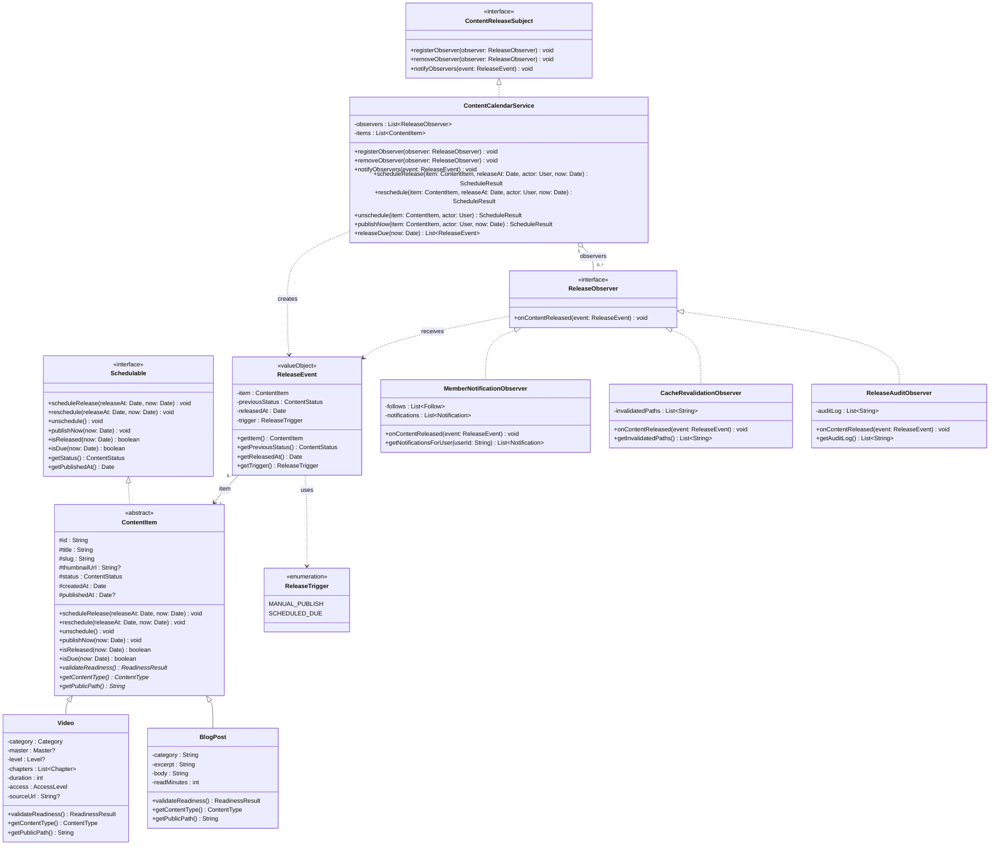

# Phase 2 — Design Problem & Observer Pattern Specification (Content Calendar)

| Full Name          | Student ID | Email Address                    |
| ------------------ | ---------- | -------------------------------- |
| Yahya Chebab       | 300211534  | yahya.chebab@student.ufv.ca      |
| Riley Van Dam      | 300194967  | Riley.vandam@student.ufv.ca      |
| Manbir Singh Sidhu | 300200328  | ManbirSingh.Sidhu@student.ufv.ca |
| Jovan Siekham      | 300183572  | anmolak.siekham@student.ufv.ca   |

---

## 0. Phase 2 Scope, Requirements, and Steps

### Scope
Phase 2 identifies a real architectural bottleneck in the **Content Calendar** feature slice and solves it using the **Observer** design pattern. It specifies the pattern participants, updates the Phase 1 UML class diagram to include the Observer hierarchy, traces the runtime interaction with a sequence diagram, and defines the exact contract that Phase 3 (Java) and Phase 4 (TypeScript) implement.

### Steps Completed in This Phase
1. Analyzed how the existing EverGrace codebase handles content publication across `src/actions/admin.ts`, `src/actions/admin-video.ts`, `src/app/api/mux/webhook/route.ts`, and `src/lib/notifications.ts`.
2. Formulated the concrete design problem introduced when scheduled releases (`releaseDue` and `publishNow` for both `Video` and `BlogPost`) are added.
3. Evaluated all three candidate patterns (**Observer**, **Decorator**, **Factory**) against the problem and justified selecting **Observer**.
4. Extended the Phase 1 UML class diagram with `ContentReleaseSubject`, `ReleaseObserver`, `ReleaseEvent`, and the concrete observers.
5. Created a UML sequence diagram showing how a scheduled release fans out to observers.
6. Defined the exact Java-to-TypeScript role mapping for Phases 3 and 4.

---

## 1. The Design Problem in the Content Calendar Feature

### 1.1 How EverGrace Currently Handles Publishing
In the existing codebase, transitioning a video to `PUBLISHED` happens in three separate places:
1. `setVideoStatus()` in `src/actions/admin.ts`
2. `updateVideo()` in `src/actions/admin-video.ts`
3. `POST()` in `src/app/api/mux/webhook/route.ts`

In each place, the caller manually performs a sequence of post-publish side effects:
```ts
// 1. Mutate status in the database
await prisma.video.update({ where: { id }, data: { status: "PUBLISHED", publishedAt } });

// 2. Call the notification fan-out directly
if (status === "PUBLISHED" && before.status !== "PUBLISHED") {
  notified = await fanOutNewVideo(id);
}

// 3. Call Next.js route cache invalidation for every affected page
revalidatePath("/admin/videos");
revalidatePath(`/admin/videos/${id}`);
revalidatePath("/library");
revalidatePath(`/library/${slug}`);
revalidatePath("/dashboard");
```

### 1.2 Why This Breaks Down with the Content Calendar
When we introduce the **Content Calendar** (`ContentCalendarService`), content transitions from `SCHEDULED` (or `DRAFT`) to `PUBLISHED` through new paths (`publishNow` by an admin on the calendar screen, and `releaseDue(now)` when the scheduled timestamp arrives for a batch of videos and blog posts). Every time a `ContentItem` goes live, **three distinct subsystems** must react:

1. **Subscriber Notification Fan-Out:** If the released item is a `Video`, every member whose `Follow` matches the video's `Category`, `Master`, or `Level` must receive at most one prioritized `Notification` (`"New from Master …"` > `"New in Level …"` > `"New in <Category>"`).
2. **Route & View Cache Revalidation:** Next.js Server Component caches must be invalidated for `/admin/content/calendar` plus the item's public routes (`/library`, `/library/<slug>`, `/dashboard` for videos; `/blog`, `/blog/<slug>` for blog posts) so members immediately see the newly released content.
3. **Release Audit & Roadmap Telemetry:** Staff need an audit record of when each scheduled item transitioned to `PUBLISHED`, whether it was triggered automatically (`SCHEDULED_DUE`) or manually (`MANUAL_PUBLISH`), and how many members were notified.

If `ContentCalendarService` directly imports and calls notification queries, Next.js cache functions, and audit loggers inside `publishNow()` and `releaseDue()`, three concrete design flaws emerge:

| Flaw | Consequence in EverGrace |
| ---- | ------------------------ |
| **Violation of Single Responsibility (SRP)** | `ContentCalendarService` would simultaneously manage calendar state transitions, follower priority rules, Next.js route topology, and audit formatting. |
| **Violation of Open/Closed Principle (OCP)** | Adding a new post-release reaction later (e.g., sending an email digest via `src/lib/mail.ts` when a scheduled video drops) would require editing `ContentCalendarService` and every publish action. |
| **Broken Layer Isolation (`domain.ts`)** | EverGrace's architecture (`docs/ARCHITECTURE.md`) mandates that domain logic in `src/lib/domain.ts` have **zero imports** from Prisma, React, or Next.js so it can be unit-tested in isolation. Hardcoding ` prisma.notification` and `revalidatePath` into the release coordinator makes pure unit testing impossible without mocking the database and Next.js runtime. |

---

## 2. Pattern Selection: Why Observer (vs. Decorator and Factory)

We evaluated all three classic design patterns from the Mini-Project 2 specification against our feature:

| Pattern | How It Would Apply to Content Calendar | Why Selected or Rejected |
| ------- | -------------------------------------- | ------------------------ |
| **Observer** *(Behavioral)* | `ContentCalendarService` acts as the **Subject** (`ContentReleaseSubject`). When a `ContentItem` transitions to `PUBLISHED`, the service emits a `ReleaseEvent` to all registered **`ReleaseObserver`** instances (`MemberNotificationObserver`, `CacheRevalidationObserver`, `ReleaseAuditObserver`). | ✅ **Selected.** Directly solves the one-to-many post-release side-effect coupling. The scheduler only knows the `ReleaseObserver` interface; it stays framework-free, open for new listeners (OCP), and testable with in-memory observers. |
| **Decorator** *(Structural)* | Wraps a `ContentItem` in decorator layers that add runtime responsibilities (e.g., `SafetyFlaggedVideoDecorator`, `EarlyAccessPreviewDecorator`). | ❌ **Rejected as primary pattern.** Decorator modifies how an individual object responds to method calls on the same interface; it does not coordinate broadcasting a state transition to independent infrastructure subsystems (notifications, cache, audit). |
| **Factory** *(Creational)* | A `ContentItemFactory` creates either a `Video` or `BlogPost` domain object from a database row or form payload based on `ContentType`. | ❌ **Rejected as primary pattern.** While useful for instantiating `Video` vs. `BlogPost` (and we use a small factory helper in the query layer), object creation is trivial compared to the behavioral coupling when scheduled content goes live. |

---

## 3. Observer Pattern Structure & Participants

### 3.1 Participant Roles

| Pattern Role | Class / Interface Name | Responsibility |
| ------------ | ---------------------- | -------------- |
| **Subject («interface»)** | `ContentReleaseSubject` | Declares `registerObserver(o)`, `removeObserver(o)`, and `notifyObservers(event)`. |
| **Concrete Subject** | `ContentCalendarService` | Maintains the list of `ReleaseObserver` instances. Executes scheduling use cases (`scheduleRelease`, `reschedule`, `unschedule`, `publishNow`, `releaseDue`). Whenever an item transitions to `PUBLISHED`, builds a `ReleaseEvent` and calls `notifyObservers(event)`. |
| **Event Payload («valueObject»)** | `ReleaseEvent` | Immutable record carrying the released `ContentItem`, its `previousStatus` (`DRAFT` or `SCHEDULED`), the `releasedAt` timestamp, and the `trigger` (`MANUAL_PUBLISH` or `SCHEDULED_DUE`). |
| **Observer («interface»)** | `ReleaseObserver` | Declares `onContentReleased(event: ReleaseEvent): void` (or `Promise<void>` in TypeScript). |
| **Concrete Observer 1** | `MemberNotificationObserver` | Inspects `event.getItem()`. If it is a `Video`, matches all `Follow` records for the video's `Category`, `Master`, and `Level`, deduplicates per user by priority (`Master > Level > Category`), and creates `Notification` records. |
| **Concrete Observer 2** | `CacheRevalidationObserver` | Inspects `event.getItem().getPublicPath()` and `getContentType()`, and invalidates `/admin/content/calendar`, `/dashboard`, and Either `/library` + `/library/<slug>` or `/blog` + `/blog/<slug>`. |
| **Concrete Observer 3** | `ReleaseAuditObserver` | Appends a structured `ReleaseAuditEntry` recording the item ID, slug, content type, transition (`SCHEDULED -> PUBLISHED`), trigger, and timestamp so staff can verify automated releases. |

### 3.2 Class Diagram — Observer Pattern Integrated with Content Calendar



### 3.3 Relationship Classification for New Observer Classes

| Relationship | UML Type | Multiplicity & Roles | Justification |
| ------------ | -------- | -------------------- | ------------- |
| `ContentCalendarService` ⇢ `ContentReleaseSubject` | Interface Realization | — | The calendar service implements the Subject contract. |
| `MemberNotificationObserver`, `CacheRevalidationObserver`, `ReleaseAuditObserver` ⇢ `ReleaseObserver` | Interface Realization | — | Each listener implements the Observer contract so the subject treats them polymorphically. |
| `ContentCalendarService` ◇── `ReleaseObserver` | Aggregation | `1` subject to `0..*` `observers` | Observers are registered with the service from the outside and can outlive a single service invocation. |
| `ReleaseEvent` ──> `ContentItem` | Directed Association | `0..*` events to `1` `item` | Each event references the `ContentItem` that just transitioned to `PUBLISHED`. |
| `ContentCalendarService` ──> `ReleaseEvent` | Dependency («create») | — | Created when a transition to `PUBLISHED` occurs and passed immediately to `notifyObservers()`. |

---

## 4. Runtime Sequence Diagram (`scheduleRelease` → `releaseDue`)

```mermaid
sequenceDiagram
    actor Admin
    participant Service as ContentCalendarService
    participant Video as Video (extends ContentItem)
    participant NotifObs as MemberNotificationObserver
    participant CacheObs as CacheRevalidationObserver
    participant AuditObs as ReleaseAuditObserver

    Note over Admin,AuditObs: Phase A — Admin schedules a draft video for a future date
    Admin->>Service: scheduleRelease(video, releaseAt, admin, now)
    Service->>Video: validateReadiness()
    Video-->>Service: ReadinessResult(ok=true)
    Service->>Video: scheduleRelease(releaseAt, now)
    Note right of Video: status = SCHEDULED<br/>publishedAt = releaseAt
    Service-->>Admin: ScheduleResult(ok=true, "Scheduled for ...")

    Note over Admin,AuditObs: Phase B — Clock reaches releaseAt; releaseDue(now) runs
    Admin->>Service: releaseDue(now)
    Service->>Video: isDue(now)
    Video-->>Service: true (status == SCHEDULED && publishedAt <= now)
    Service->>Video: publishNow(now)
    Note right of Video: status = PUBLISHED
    Service->>Service: notifyObservers(ReleaseEvent)
    Service->>NotifObs: onContentReleased(event)
    Note right of NotifObs: Matches Follow rows,<br/>deduplicates by priority,<br/>inserts Notification rows
    Service->>CacheObs: onContentReleased(event)
    Note right of CacheObs: Revalidates /library,<br/>/library/<slug>, /dashboard,<br/>/admin/content/calendar
    Service->>AuditObs: onContentReleased(event)
    Note right of AuditObs: Records SCHEDULED -> PUBLISHED<br/>transition in audit log
    Service-->>Admin: List<ReleaseEvent>
```

---

## 5. Cross-Language Translation Contract (Java ↔ TypeScript)

To make sure our Phase 3 Java implementation and Phase 4 TypeScript implementation represent the exact same design, every type and method maps 1-to-1:

| Concept | Phase 3 Java (`mini-project-2/java/`) | Phase 4 TypeScript (`evergrace-app/src/`) |
| ------- | ------------------------------------- | ----------------------------------------- |
| Status Enum | `enum ContentStatus { DRAFT, PROCESSING, SCHEDULED, PUBLISHED }` | `VIDEO_STATUSES = ["DRAFT", "PROCESSING", "SCHEDULED", "PUBLISHED"] as const` (`src/lib/domain.ts`) |
| Schedulable Interface | `interface Schedulable` (`Schedulable.java`) | `interface SchedulableContent` (`src/lib/domain.ts`) |
| Abstract Base Class | `abstract class ContentItem implements Schedulable` (`ContentItem.java`) | `abstract class ContentItem implements SchedulableContent` (`src/lib/domain.ts`) |
| Concrete Subclasses | `class Video extends ContentItem`, `class BlogPost extends ContentItem` | `class VideoContent extends ContentItem`, `class BlogPostContent extends ContentItem` (`src/lib/domain.ts`) |
| Observer Interface | `interface ReleaseObserver` (`ReleaseObserver.java`) | `interface ReleaseObserver` (`src/lib/domain.ts`) |
| Subject Interface | `interface ContentReleaseSubject` (`ContentReleaseSubject.java`) | `interface ContentReleaseSubject` (`src/lib/domain.ts`) |
| Event Object | `final class ReleaseEvent` (`ReleaseEvent.java`) | `type ReleaseEvent` (`src/lib/domain.ts`) |
| Subject / Coordinator | `class ContentCalendarService implements ContentReleaseSubject` | `class ContentReleasePublisher implements ContentReleaseSubject` (`src/lib/domain.ts`) + Server Actions (`src/actions/admin-content.ts`) |
| Concrete Observers | `MemberNotificationObserver`, `CacheRevalidationObserver`, `ReleaseAuditObserver` | `MemberNotificationObserver` (`src/lib/notifications.ts`), `CacheRevalidationObserver` (`src/actions/admin-content.ts`), `ReleaseAuditObserver` (`src/lib/domain.ts`) |

